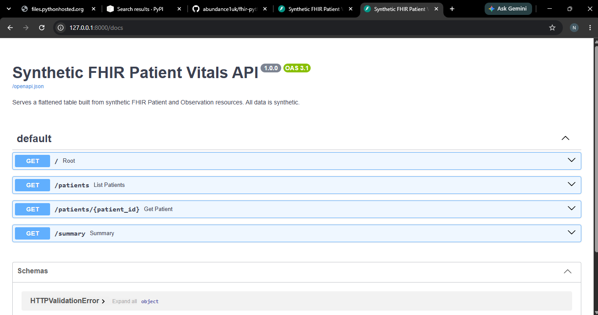

# FHIR + Python: create, retrieve, validate and transform health records

A small healthcare interoperability project. It creates synthetic FHIR `Patient` and `Observation` resources on the public HAPI FHIR test server, retrieves them with Python, validates them, and flattens them into a clean table.

**Author:** Abundance-Idara Felix George
**Tools:** Python, `requests`, `pandas`, FHIR R4, HAPI FHIR public test server

> **Data note:** all records are synthetic. The HAPI public server is open to everyone, so no real patient data was or should ever be sent to it.

## What the pipeline does

| Script | Step | Output |
|---|---|---|
| `01_create_resources.py` | `POST` 3 synthetic Patients, each with a heart rate and a body temperature Observation | `created_ids.json` |
| `02_retrieve_resources.py` | `GET` a Patient by ID, then `SEARCH` for my patients (by identifier) and their Observations (by subject) | `retrieved_resources.json` |
| `03_validate_resources.py` | Check each resource against data-quality rules (and against the FHIR schema if `fhir.resources` is installed), then self-test on deliberately broken records | `validation_report.csv` |
| `04_transform_to_table.py` | Flatten the nested JSON into tables | `patients.csv`, `observations_long.csv`, `patients_with_vitals.csv` |
| `api.py` (bonus) | Serve the clean table as a small FastAPI JSON API | Interactive docs at `/docs` |

## Example output

The final clean table (`patients_with_vitals.csv`):

| patient_id | mrn | given_name | family_name | gender | birth_date | age_years | heart_rate_bpm | temperature_c |
|---|---|---|---|---|---|---|---|---|
| 524813 | demo-001 | Ada | Demo | female | 1990-04-12 | 36 | 72 | 36.8 |
| 524816 | demo-002 | Tunde | Demo | male | 1984-09-30 | 42 | 88 | 37.9 |
| 524819 | demo-003 | Ngozi | Demo | female | 2001-01-25 | 25 | 64 | 36.5 |

Validation result: **9 of 9 resources passed** (3 Patients, 6 Observations). The self-test confirmed that 3 intentionally broken records (misspelt gender, future birth date, implausible temperature, invalid status, missing patient reference) were all rejected.

## How to run it

```
pip install requests pandas
python 01_create_resources.py
python 02_retrieve_resources.py
python 03_validate_resources.py
python 04_transform_to_table.py
```

Optional: `pip install fhir.resources` enables the FHIR schema check in step 3. The run documented above used the data-quality rules only.

## API (bonus)

`api.py` is a small FastAPI app that serves the clean table as JSON, so other programs can query it.

```
pip install fastapi uvicorn
python -m uvicorn api:app --reload
```

Then open `http://127.0.0.1:8000/docs` for the interactive documentation.

| Endpoint | Returns |
|---|---|
| `GET /patients` | All patients, with optional filters: `gender`, `min_age`, `max_age`, `min_temp` |
| `GET /patients/{patient_id}` | One patient, or a `404` if the ID does not exist |
| `GET /summary` | Patient count, split by gender, and mean age, heart rate and temperature |

Example response from `GET /summary`:

```json
{
  "patients": 3,
  "by_gender": {"female": 2, "male": 1},
  "mean_age_years": 34.3,
  "mean_heart_rate_bpm": 74.7,
  "mean_temperature_c": 37.1
}
```



## FHIR concepts

See [resources_explained.md](resources_explained.md) for a plain-language explanation of the Patient and Observation resources, references between them, Bundles, LOINC and UCUM codes, and why validation and flattening matter.

## What this project demonstrates

- Working with a REST API (`POST`, `GET`, search parameters, status codes)
- FHIR resource structure, references and standard terminologies (LOINC, UCUM)
- Data validation with explicit rules and a test that proves the rules catch errors
- Flattening nested JSON into an analysis-ready table with pandas

## Limitations and next steps

- Tiny, synthetic dataset on a shared test server that is wiped periodically; IDs will differ on every run.
- Only two resource types and two vital signs.
- The API reads a CSV file and has no authentication, so it is a local demo only, not a production service.
- Possible extensions: more resource types (Encounter, Condition), and full schema validation with `fhir.resources`.
